# CampusCollab

**Publish campus tasks. Let students join. Review the work.**

[简体中文](README.md) · [Run locally](#run-locally) · [Documentation](docs/README.md)

[](https://github.com/tswawa/CampusCollab/actions/workflows/ci.yml)

CampusCollab connects teachers who organize campus work with students who take part. Teachers publish tasks and set participation and submission requirements. Students find tasks, join, and submit their results. Teachers review the work, confirm participation time, and export the final records.

Each institution hosts its own instance and chooses English or Chinese during setup.

| Role | Workspace | Main actions |
| --- | --- | --- |
| Teacher / coordinator | Coordinator workspace | Publish tasks, manage participants, review submissions, export results |
| Student / participant | Participant home and task hall | Find tasks, sign up, track progress, submit work |
| Administrator | Admin console | Approve accounts, manage organizations and settings, transfer task ownership |

## 1. Sign in and open your workspace

Sign in with your account. CampusCollab opens the workspace assigned to your role. Teachers land on a workspace with a **Publish task** entry, task counts, and pending reviews. Students see their participation progress and links to available tasks.

<table>
<tr><th>Sign in</th><th>Teacher / coordinator</th><th>Student / participant</th></tr>
<tr valign="top">
<td>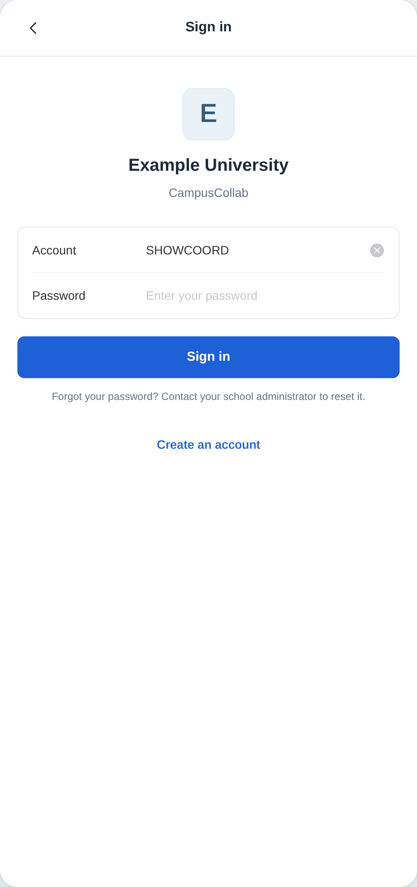</td>
<td>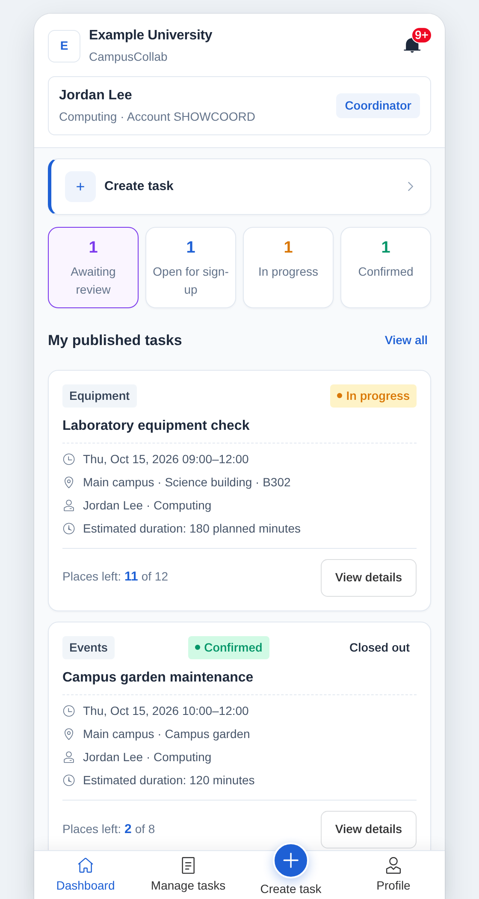</td>
<td>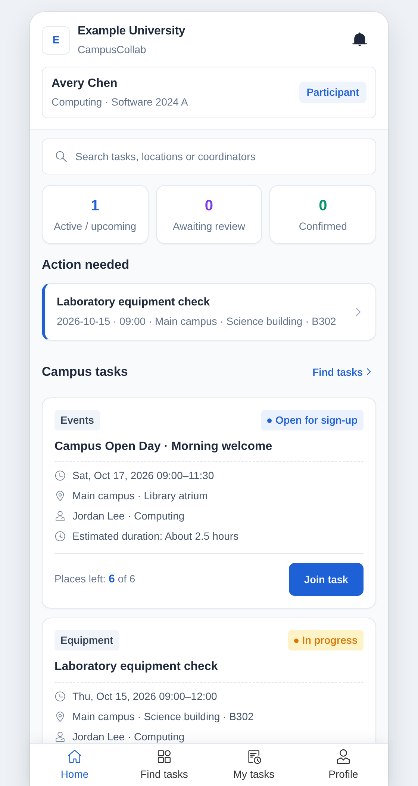</td>
</tr>
</table>

Accounts that an administrator creates or resets must set a new password at the first sign-in, and everyone can change their password on the Profile page. After five failed sign-ins, the account is locked for up to 15 minutes; an administrator's password reset unlocks it at once.

## 2. Publish a task

The four-step form takes the coordinator through task details; the schedule, places, evidence and review rules; contact details; and a final preview. Enter the task name, location, description, and checklist, then set the dates, places available, audience, required evidence, and participation method. The duration follows the start and end times and prefills the planned minutes.

<table>
<tr><th>Task details</th><th>Schedule and review rules</th><th>Preview</th></tr>
<tr valign="top">
<td>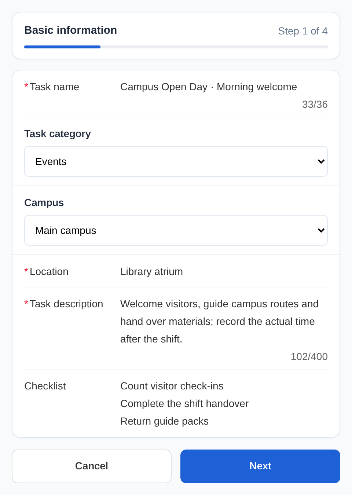</td>
<td>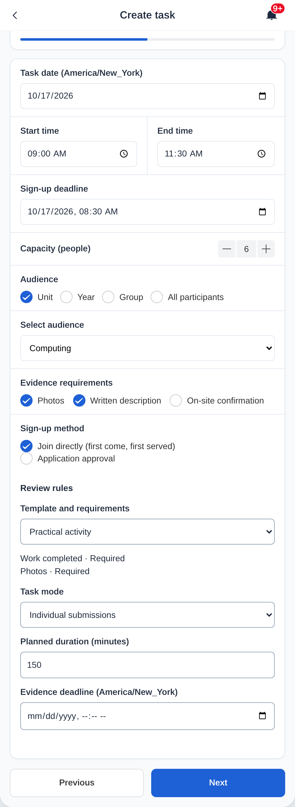</td>
<td>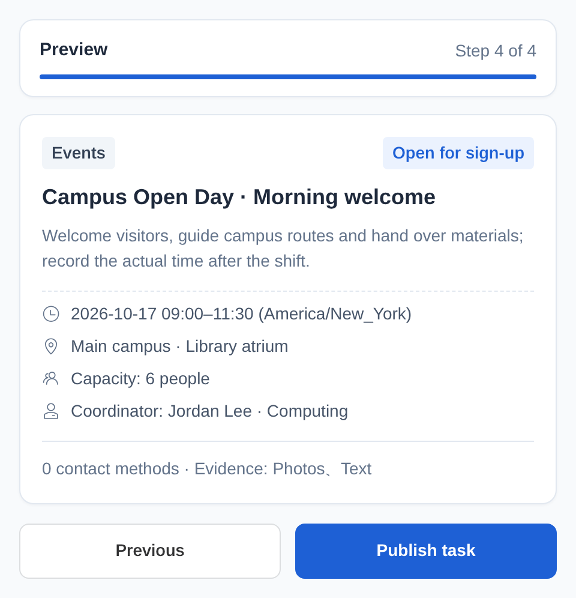</td>
</tr>
</table>

## 3. Students join a task and submit their work

The task hall lets students browse, search, and filter available work. Opening a task shows the schedule, location, requirements, and available places. A task can accept participants directly or collect applications for the coordinator to approve. After the work, students describe what they completed, record their time, and attach photos where required; they then return to the task page while the work awaits review.

<table>
<tr><th>Task hall</th><th>Task details</th><th>Submit work</th></tr>
<tr valign="top">
<td>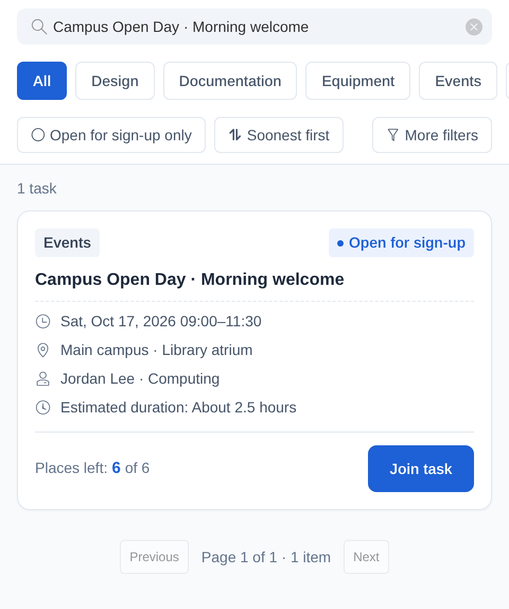</td>
<td>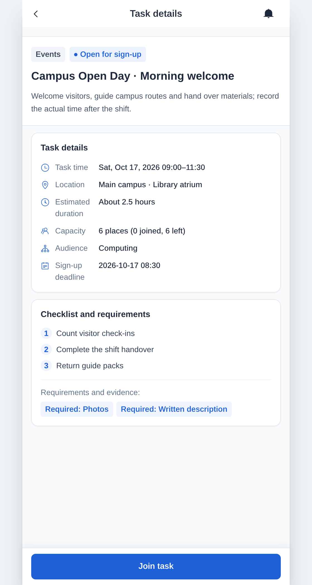</td>
<td>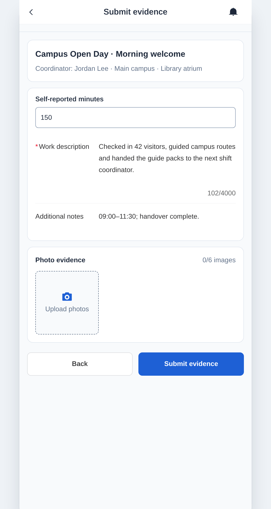</td>
</tr>
</table>

## 4. Review participants and follow up

The coordinator's roster shows who has submitted, who needs a correction, and whose work is approved. Filter by status or search by name and ID. Existing CSV rosters can also be previewed and imported.

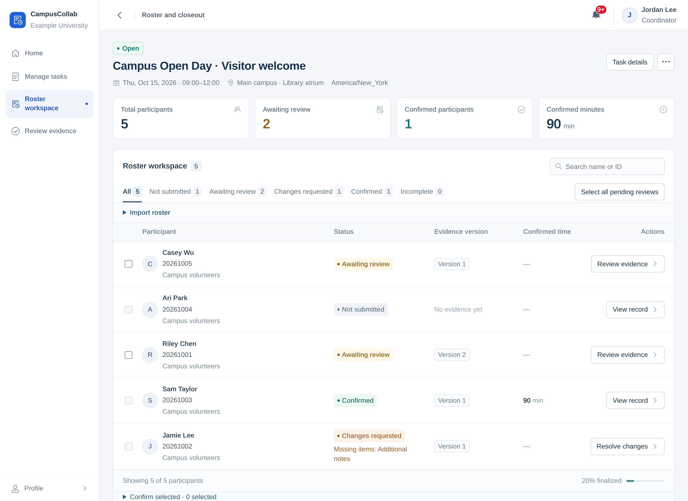

A review can ask for a specific missing detail, such as the actual departure time. Each resubmission retains the earlier version and feedback. The coordinator approves a version and records the confirmed time; ready submissions can be reviewed in batches. In the review list, each submission shows the student's reported minutes and the planned minutes, prefilled as the confirmed time, and flags work submitted before the task started.

<details>
<summary>Submission versions and correction feedback</summary>

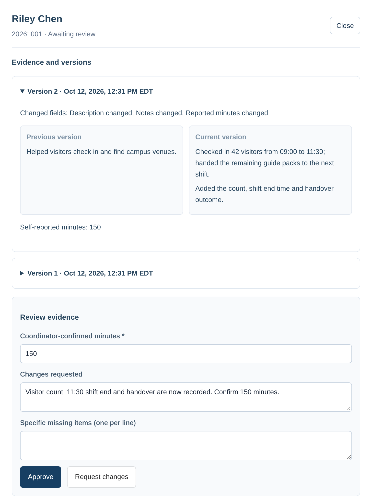

</details>

<details>
<summary>Shared materials for a group activity</summary>

For group activities, the coordinator adds a shared activity record and confirms each person's result and time. Personal submissions can be required alongside the shared record.

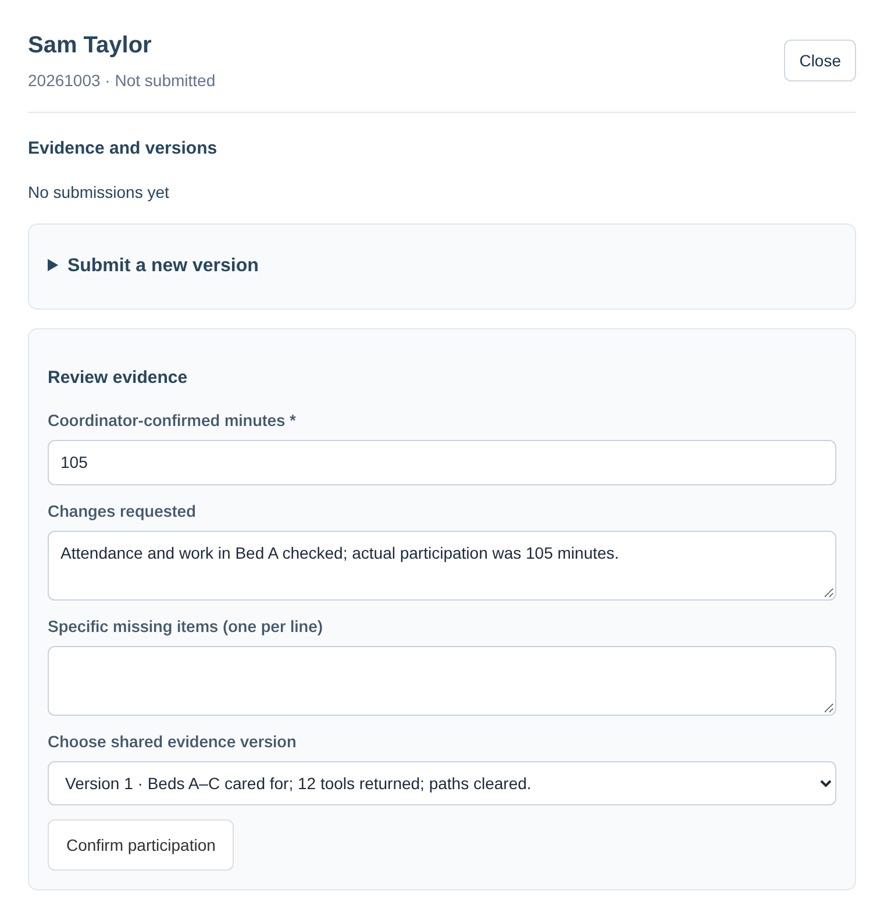

</details>

## 5. Close out and export

Download a CSV, an Excel workbook, or a ZIP containing the roster and approved materials. The roster preserves completed, withdrawn, and incomplete outcomes. Later corrections create a new completion version and retain the earlier record.

Each row starts with the participant's name, student or staff number and external ID, followed by organization, roster source, outcome and confirmed minutes; internal IDs come last. Files are named after the task and the result version.

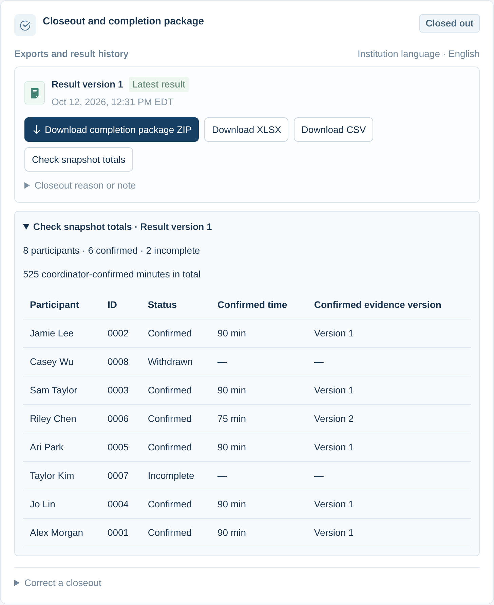

## Administration

Administrators approve accounts, manage organizations and institution settings, transfer task ownership, and handle notifications and data retention. They choose how students self-register (open, open with approval, or closed), can approve all pending accounts on a page at once, and reset passwords. Until the first task exists, the admin home shows a short getting-started checklist.

<details>
<summary>Open the administrator overview</summary>

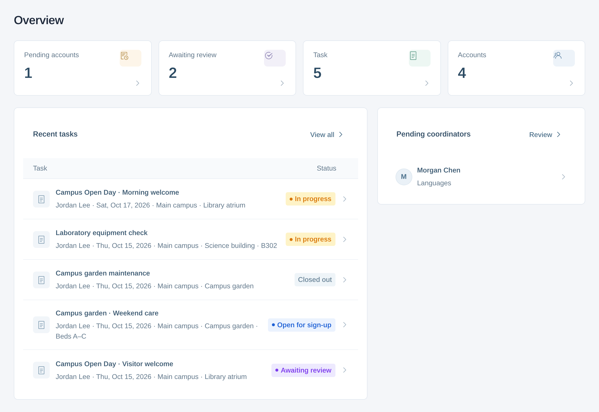

</details>

All institutions, people and activities in the screenshots are fictional.

## Run locally

Requires Node.js `>=24.13.1 <25` and npm.

```sh
git clone https://github.com/tswawa/CampusCollab.git
cd CampusCollab
npm ci
```

Copy `.env.example` to `.env`, then start the app:

```sh
npm run dev
```

Open [localhost:5173](http://localhost:5173). The API runs on port `3000`; database migrations run at startup.

On the first visit, choose the institution language, enter its details and time zone, choose how students register, and create the administrator account. Use the setup code from `SETUP_TOKEN` in `.env`, or read the generated `data/campus.sqlite.setup-token` file on the host when that setting is empty.

## Deploy

Configure `.env` with `NODE_ENV=production`, the public HTTPS `APP_ORIGIN`, and persistent database, upload, and backup paths. Then run:

```sh
npm run build
npm start
```

The server listens on `127.0.0.1:3000` by default. Use a reverse proxy for HTTPS, and set `TRUST_PROXY` to that proxy's address. The [operations guide](docs/operations.en.md) covers configuration, backup, upgrades, and recovery.

## Development

Vue 3, Pinia, and Vant on the frontend; Fastify and Node's built-in SQLite on the backend.

```sh
npm run format:check
npm run type-check
npm run test:api
npm run test:client
npx playwright install chromium
npm run test:e2e
```

- [Architecture and scope](docs/ARCHITECTURE.md#english-summary)
- [Contributing](CONTRIBUTING.md)
- [Product plan and research](PLAN.en.md)
- [Test coverage](docs/verification.md#english)
- [Security reporting](SECURITY.md)

## License

[AGPL-3.0-only](LICENSE). CampusCollab is derived from the ZVMS4 frontend and retains its [MIT copyright and permission notice](LICENSES/ZVMS-MIT.txt). See [NOTICE](NOTICE). Production builds include the corresponding source archive at `/source.zip`.
