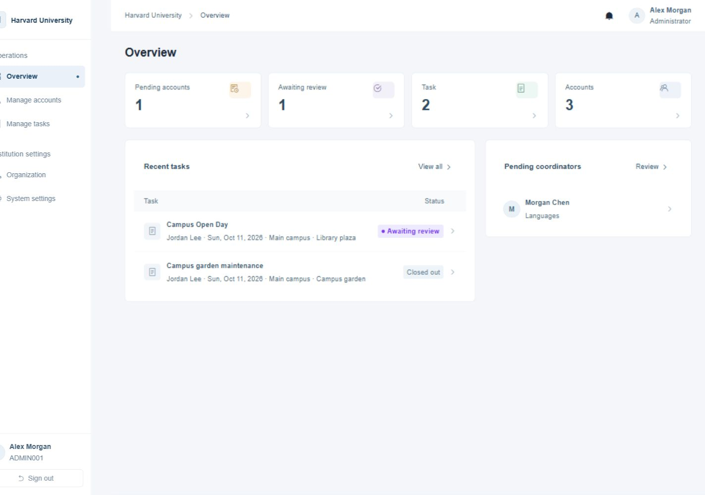
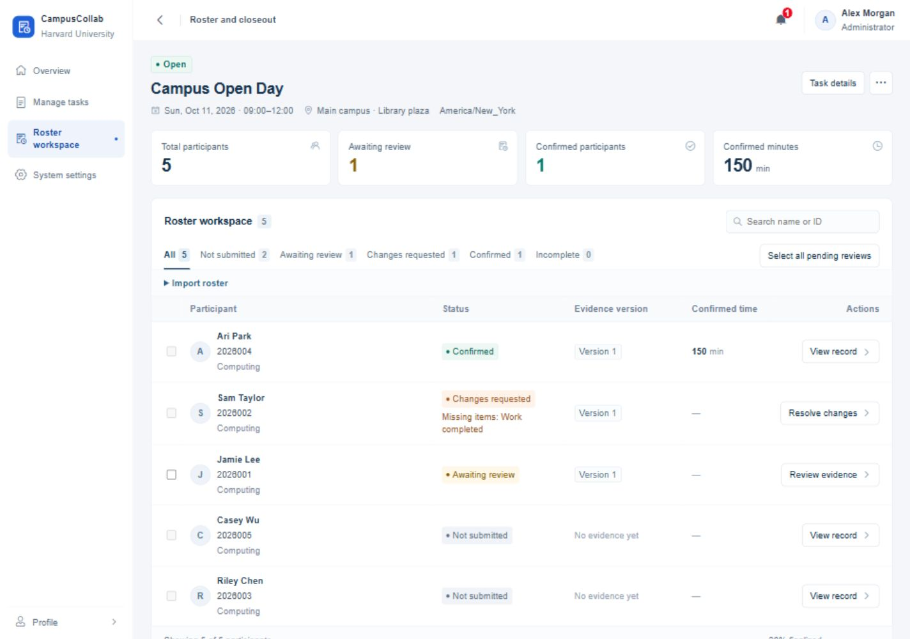

# CampusCollab

[简体中文](README.md) · [Deployment and use](docs/operations.en.md) · [Architecture](docs/ARCHITECTURE.md#english-summary) · [Contributing](CONTRIBUTING.md)

CampusCollab is a self-hosted app for campus tasks and activities. Coordinators publish tasks, manage rosters, review submissions and confirm participation time. Participants sign up, submit their work and check the outcome. Once an activity is complete, coordinators can export the roster and approved evidence.

Each institution runs its own instance with a SQLite database. During setup, the administrator chooses Chinese or English for the interface, system notifications and exports. Text written by users stays in its original language.

## Features

- **Tasks and rosters:** Create individual tasks or group activities, accept sign-ups, or preview and import a CSV roster. Roster imports do not create login accounts.
- **Submission review:** Request corrections and approve a specific version while keeping the submission and review history. Image uploads support JPEG, PNG and WebP.
- **Group activities:** Share activity evidence and confirm each participant's outcome and actual time separately.
- **Exports:** Download rosters as CSV or XLSX, or a ZIP with approved evidence. Corrections after closeout create a new snapshot and preserve the previous record.
- **Administration:** Approve accounts, transfer task ownership, configure institution details and retention periods, and optionally enable email notifications.

## Screenshots

These screenshots use Harvard University as an example name. People and activities are fictional; no university use or endorsement is implied.

**Admin overview**



**Tasks and participant rosters**



## Run locally

Requires Node.js `>=24.13.1 <25` and npm. In the project root, copy `.env.example` to `.env`, then run:

```sh
npm ci
npm run dev
```

Open `http://localhost:5173`. The API defaults to port `3000`, and database migrations run automatically at startup.

The first visit opens setup. Choose a language, enter the institution details and time zone, and create an administrator account. Use the setup code from `SETUP_TOKEN` in `.env`. If left empty, the first startup generates a code file beside the database, at `data/campus.sqlite.setup-token` with the default configuration. The deployment owner reads this file on the host. Setup runs once; there are no default credentials.

For terminal setup, run `npm run build` first, then `npm run admin:init` while the application is stopped.

## Deploy

Run a single Node.js instance. In `.env`, set `NODE_ENV=production`, the public HTTPS `APP_ORIGIN`, and separate persistent paths for the database, images and backups. Then run:

```sh
npm run build
npm start
```

The server listens on `127.0.0.1:3000` by default. Use a reverse proxy for HTTPS. See the [deployment and recovery guide](docs/operations.en.md) for configuration, backups and upgrades.

## Development

The frontend uses Vue 3, Pinia and Vant. The backend uses Fastify and Node's built-in SQLite.

```sh
npm run type-check
npm run test:api
npm run test:client
npx playwright install chromium
npm run test:e2e
```

Install Playwright's Chromium before running browser tests for the first time.

- [Architecture and scope](docs/ARCHITECTURE.md#english-summary)
- [Contributing](CONTRIBUTING.md)
- [Reporting security issues](SECURITY.md)
- [Documentation index](docs/README.md)

## License

Licensed under [AGPL-3.0-only](LICENSE). CampusCollab is derived from the ZVMS4 frontend and retains the [upstream MIT copyright and permission notice](LICENSES/ZVMS-MIT.txt). See [NOTICE](NOTICE). Production builds include the corresponding source archive at `/source.zip`.
