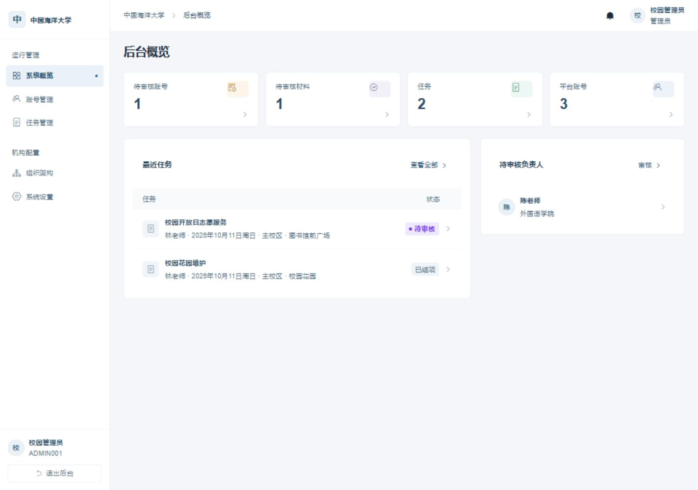
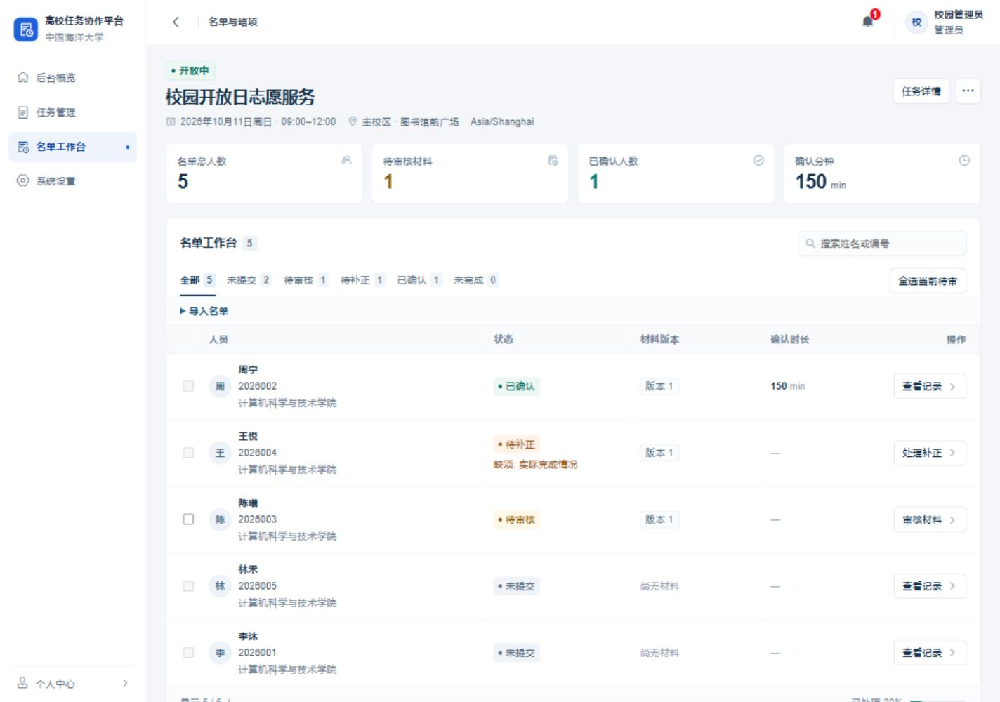

# 高校任务协作平台 · CampusCollab

[English](README.en.md) · [部署与使用](docs/operations.md) · [架构](docs/ARCHITECTURE.md) · [贡献说明](CONTRIBUTING.md)

CampusCollab 用于管理校园任务和活动。负责人发布任务、整理名单、审核材料并确认参与时长；参与者报名、提交材料和查看结果。活动结束后，可以导出名单和已确认的材料。

每所学校独立部署，使用一套 SQLite 数据库。管理员在首次初始化时选择中文或英文，界面、系统通知和导出统一使用该语言，用户填写的正文不自动翻译。

## 功能

- **任务与名单**：发布个人任务或集体活动，接受报名，也可预览并导入 CSV 名单。导入名单不会创建登录账号。
- **材料审核**：按人查看提交、提出补正、确认具体版本，保留修改和审核记录。支持 JPEG、PNG、WebP 图片。
- **集体活动**：共用一份活动材料，分别确认每个人的结果和实际参与时长。
- **结项导出**：导出 CSV、XLSX 名单，或包含已确认材料的 ZIP。结项后更正会生成新快照，保留原有记录。
- **机构管理**：审批账号、交接任务负责人、设置机构信息与保存期限，可选配置邮件通知。

## 界面

以下使用中国海洋大学名称展示中文界面。人员与活动均为虚构，不代表该校使用或背书。

**管理概览**



**任务与参与名单**



## 本地运行

需要 Node.js `>=24.13.1 <25` 和 npm。在项目根目录将 `.env.example` 复制为 `.env`，然后运行：

```sh
npm ci
npm run dev
```

打开 `http://localhost:5173`。API 默认端口为 `3000`，数据库在启动时自动迁移。

首次访问会进入初始化页面，选择语言、填写机构信息和时区，并创建管理员。安装码使用 `.env` 中的 `SETUP_TOKEN`；如果留空，首次启动会在数据库旁生成安装码文件，默认是 `data/campus.sqlite.setup-token`，由部署负责人在主机上读取。初始化只需完成一次，没有默认账号或密码。

也可以先执行 `npm run build`，再在应用停止时用 `npm run admin:init` 进行终端初始化。

## 部署

使用单个 Node.js 实例运行。先在 `.env` 中设置 `NODE_ENV=production`、实际的 HTTPS `APP_ORIGIN`，以及数据库、图片和备份的独立持久路径，再执行：

```sh
npm run build
npm start
```

服务默认监听 `127.0.0.1:3000`，通过反向代理提供 HTTPS。配置、备份、升级和恢复步骤见[部署与使用](docs/operations.md)。

## 开发

前端使用 Vue 3、Pinia 和 Vant，后端使用 Fastify 与 Node 内置 SQLite。

```sh
npm run type-check
npm run test:api
npm run test:client
npx playwright install chromium
npm run test:e2e
```

Playwright 的 Chromium 只需在首次运行浏览器测试时安装。

- [架构与项目边界](docs/ARCHITECTURE.md)
- [贡献说明](CONTRIBUTING.md)
- [安全问题报告](SECURITY.md)
- [文档索引](docs/README.md)

## 许可证

采用 [AGPL-3.0-only](LICENSE)。项目基于 ZVMS4 前端开发，保留[上游 MIT 版权和许可声明](LICENSES/ZVMS-MIT.txt)，详见 [NOTICE](NOTICE)。生产构建附带对应源码包 `/source.zip`。
