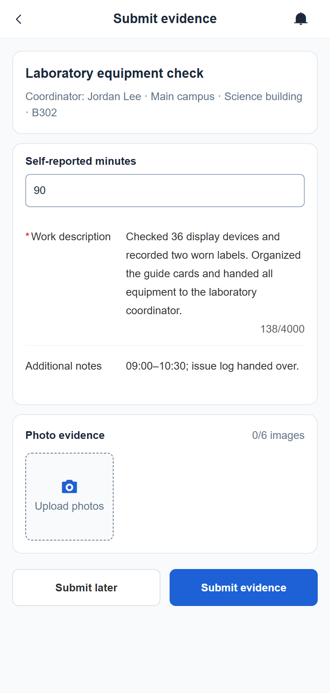

# CampusCollab

**Campus activities, from the participant list to the final report.**

[简体中文](README.zh-CN.md) · [Run locally](#run-locally) · [Documentation](docs/README.md)

[](https://github.com/tswawa/CampusCollab/actions/workflows/ci.yml)

An activity ends, and there are still submissions to collect, corrections to follow up on, and participation hours to confirm. CampusCollab puts that work next to each participant's name.

Start with a CSV roster or open sign-ups. Track each person's submissions, review their work, confirm their time, and download the final records with the approved materials. Built for campus volunteer activities, student organizations, and departmental projects.

## Find the people who need your attention

The roster shows who has submitted, who needs a correction, and whose work is approved. Filter by status or search by name and ID to pick up the next item. Existing CSV lists can be previewed before import, with student IDs kept as text.


## Follow a correction through to approval

Open a participant's record and leave a specific request, such as “Add your actual departure time.” Their next submission appears alongside the earlier versions and your feedback. Approve the version you reviewed and enter the confirmed time. Batch review is available for submissions that are ready together.


## Share the activity record, confirm each person's time

For group activities, the coordinator adds a shared activity record and confirms each participant's result. One volunteer might complete 90 minutes while another leaves after 75. The roster keeps those individual results, with personal submissions available where the activity requires them.


## Finish with a roster and its supporting materials

Close out the activity and download a CSV, an Excel workbook, or a ZIP containing the roster and approved materials. The full roster includes completed, withdrawn, and incomplete participants. Each approved record points to the material used for that decision.

Later corrections create a new version of the completion record and preserve the previous one.


## For participants and administrators

Participants can browse tasks, sign up, submit text and images, follow correction requests, and check results from a phone or desktop. Administrators manage accounts, organizations, task ownership, notifications, and data retention.

<details>
<summary>Student view on a phone</summary>



</details>

<details>
<summary>Administrator overview</summary>


</details>

Each institution runs its own Node.js and SQLite instance. During setup, the administrator selects English or Chinese for the interface, system notifications, and exports.

The screenshots use fictional activity data and Harvard University as an example institution name.

## Run locally

Requires Node.js `>=24.13.1 <25` and npm.

```sh
git clone https://github.com/tswawa/CampusCollab.git
cd CampusCollab
npm ci
```

Copy `.env.example` to `.env`, then start the app:

```sh
npm run dev
```

Open [localhost:5173](http://localhost:5173). The API runs on port `3000`; database migrations run at startup.

On the first visit, choose the institution language, enter its details and time zone, and create the administrator account. Use the setup code from `SETUP_TOKEN` in `.env`, or read the generated `data/campus.sqlite.setup-token` file on the host when that setting is empty.

## Deploy

Configure `.env` with `NODE_ENV=production`, the public HTTPS `APP_ORIGIN`, and persistent database, upload, and backup paths. Then run:

```sh
npm run build
npm start
```

The server listens on `127.0.0.1:3000` by default. Use a reverse proxy for HTTPS. The [operations guide](docs/operations.en.md) covers configuration, backup, upgrades, and recovery.

## Development

Vue 3, Pinia, and Vant on the frontend; Fastify and Node's built-in SQLite on the backend.

```sh
npm run type-check
npm run test:api
npm run test:client
npx playwright install chromium
npm run test:e2e
```

- [Architecture and scope](docs/ARCHITECTURE.md#english-summary)
- [Contributing](CONTRIBUTING.md)
- [Product plan and research](PLAN.en.md)
- [Test coverage](docs/verification.md#english)
- [Security reporting](SECURITY.md)

## License

[AGPL-3.0-only](LICENSE). CampusCollab is derived from the ZVMS4 frontend and retains its [MIT copyright and permission notice](LICENSES/ZVMS-MIT.txt). See [NOTICE](NOTICE). Production builds include the corresponding source archive at `/source.zip`.
