<div align="center">


<h1>CampusCollab</h1>

<p>高校任务协作平台<br />
任务发布 · 报名接取 · 材料提交 · 审核补正 · 时长确认 · 结项导出</p>

[](https://github.com/tswawa/CampusCollab/actions/workflows/ci.yml)


[](LICENSE)

[功能介绍](#功能介绍) · [本地运行](#本地运行) · [部署](#部署) · [开发](#开发) · [文档](docs/README.md) · [English](README.en.md)

</div>

CampusCollab 用于组织校园任务与活动：教师发布任务并设置参与条件和材料要求，学生报名参与并提交完成情况，教师审核材料、确认实际时长，最后导出结果名单和对应材料。每所学校独立部署，初始化时选择中文或英文版本。

- **教师 / 负责人**：发布任务、管理参与人员、审核材料并确认时长，结项后导出 CSV、Excel 或 ZIP。
- **学生 / 参与者**：在任务大厅查找并报名任务，提交完成情况和现场图片，跟进审核进度。
- **管理员**：审批账号、设置学生注册方式、维护组织架构与机构信息、交接任务负责人。
- **自部署**：Node.js 24 和内置 SQLite，一台服务器即可运行，数据保存在学校自己的服务器上。

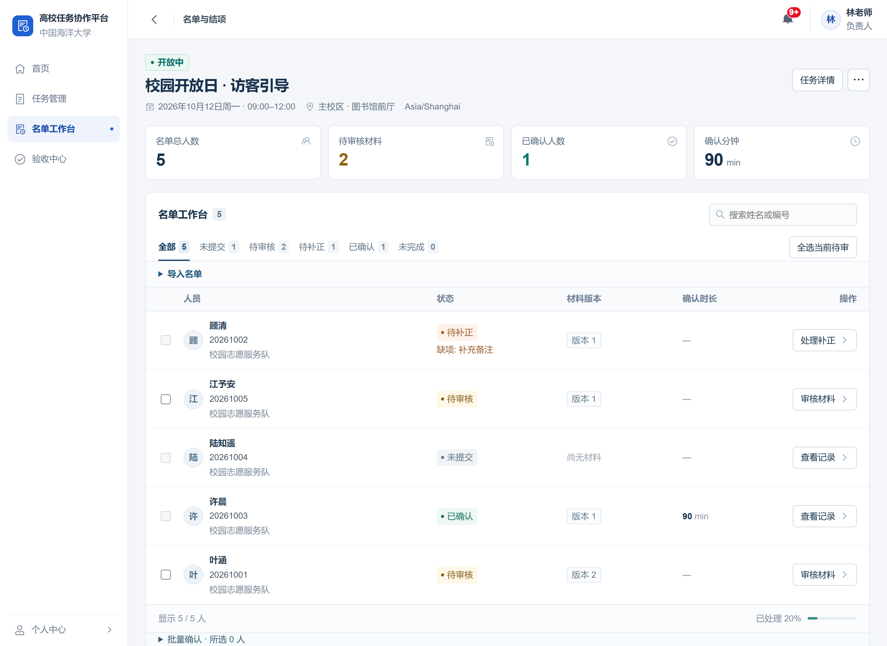

## 功能介绍

### 1. 登录，进入自己的工作台

输入账号和密码后，系统按账号角色进入对应页面。教师首页提供**发布任务**入口，显示任务数量和待验收事项；学生首页显示自己的参与进度，并提供任务浏览入口。

<table>
<tr><th>登录</th><th>教师工作台</th><th>学生首页</th></tr>
<tr valign="top">
<td></td>
<td>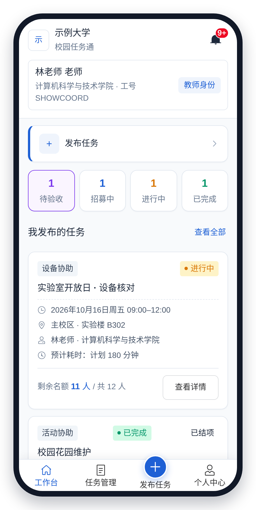</td>
<td>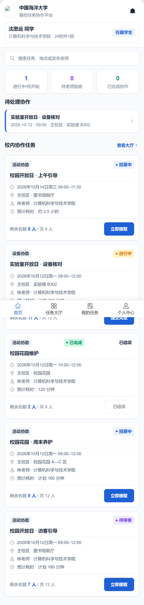</td>
</tr>
</table>

管理员创建或重置的账号，首次登录时需要先设置新密码；所有用户都可以在“个人中心”修改密码。连续 5 次登录失败后，账号会被暂时锁定（最长 15 分钟），管理员重置密码后可立即登录。

### 2. 教师发布任务

发布表单分四步：基本信息；时间、名额、凭证与验收规则；联系方式；发布预览。填写任务名称、地点、说明和工作清单后，设置日期、名额、面向范围、凭证要求和接取方式。预计耗时按开始和结束时间自动计算，并作为计划时长的默认值。

<table>
<tr><th>基本信息</th><th>时间、名额与验收规则</th><th>发布预览</th></tr>
<tr valign="top">
<td>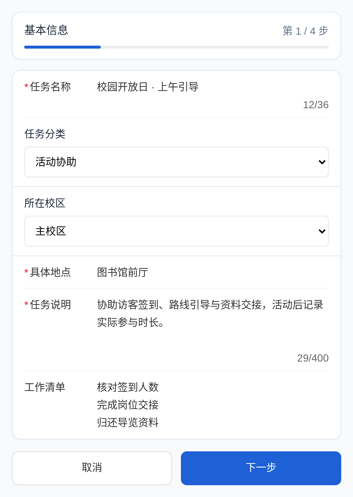</td>
<td>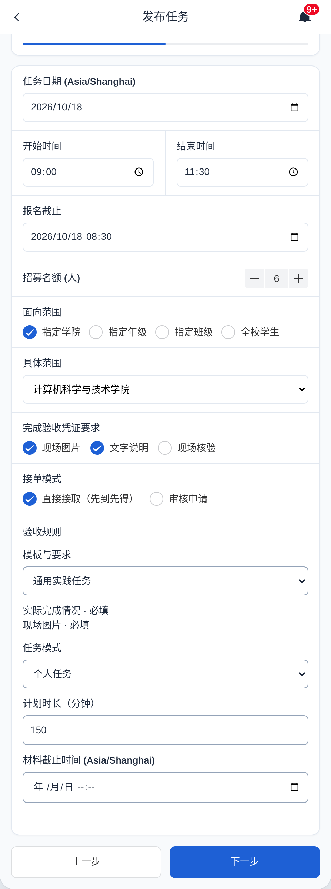</td>
<td>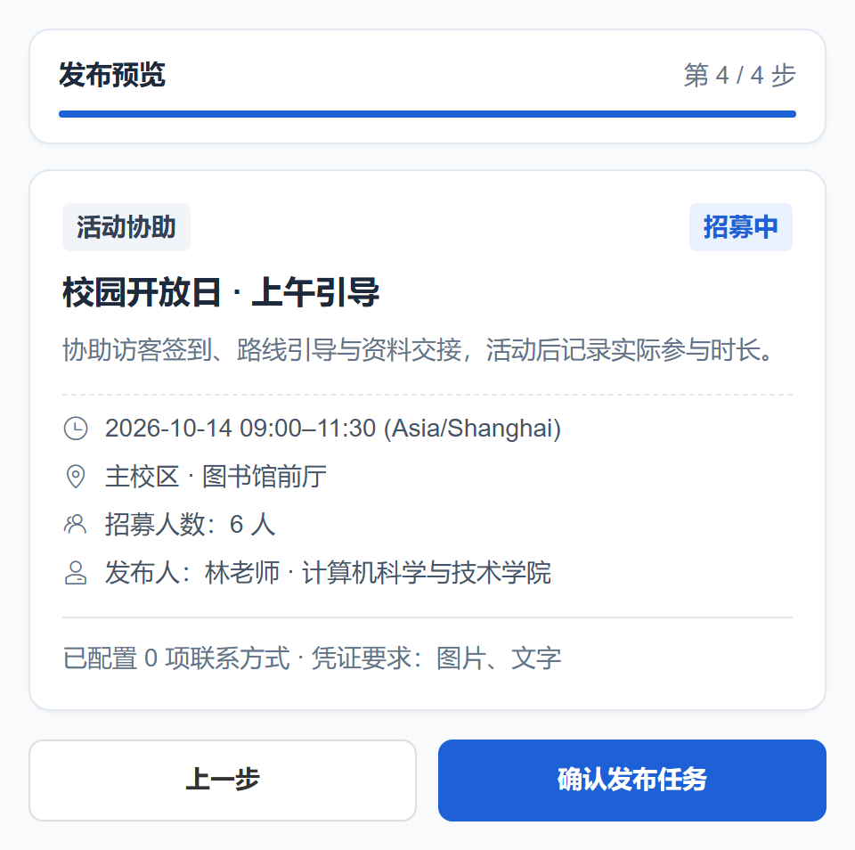</td>
</tr>
</table>

### 3. 学生报名、参与并提交材料

学生可以浏览、搜索和筛选任务，打开详情查看时间地点、工作要求和剩余名额。任务支持直接接取，也可以先申请、由教师审核。完成工作后，学生填写完成情况、自报时长，并按要求上传现场图片；提交后回到任务详情页，等待教师验收。

<table>
<tr><th>任务大厅</th><th>任务详情</th><th>提交材料</th></tr>
<tr valign="top">
<td>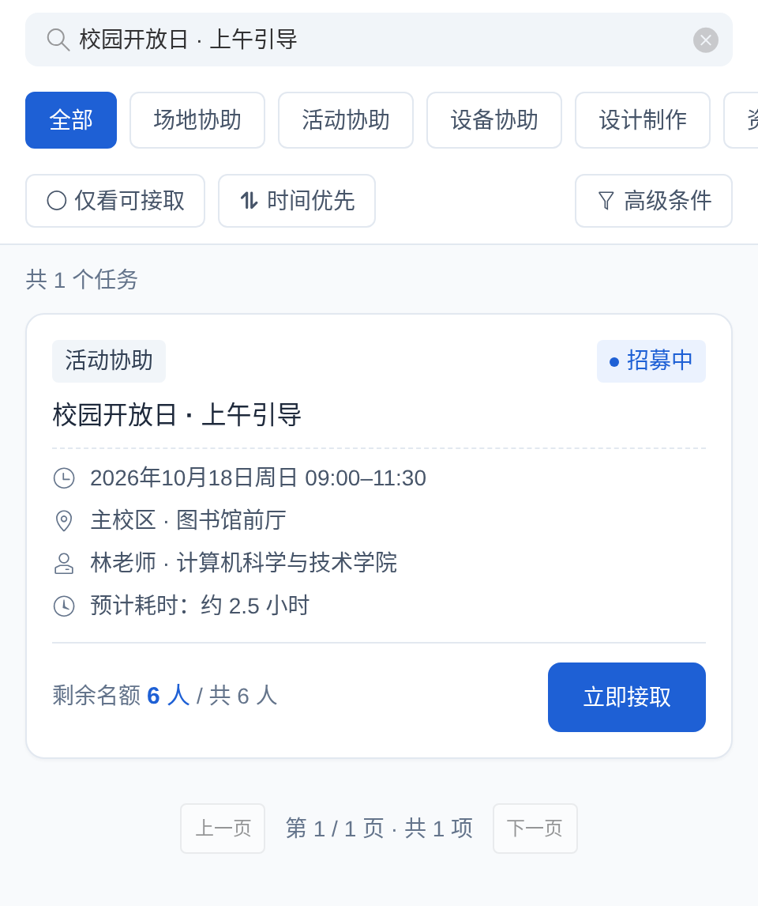</td>
<td>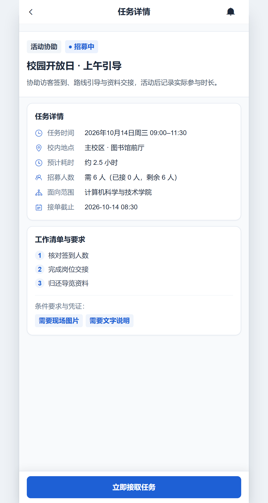</td>
<td>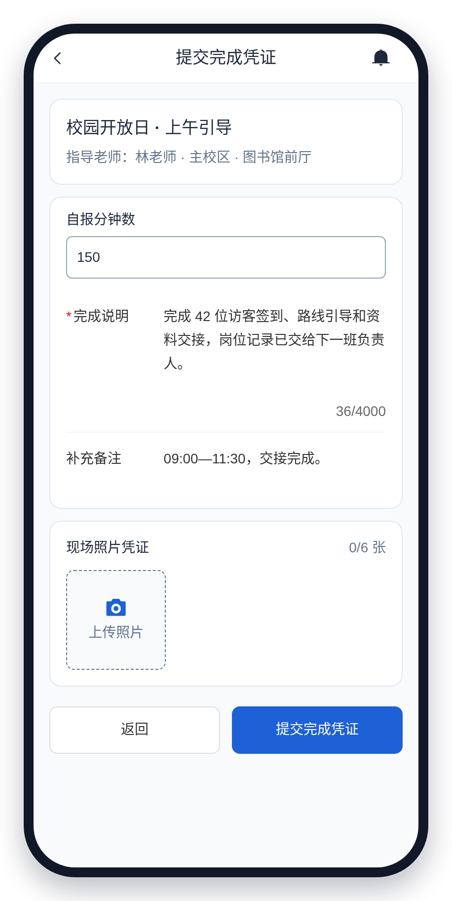</td>
</tr>
</table>

### 4. 教师按人审核，跟进补正

名单工作台显示每个人的提交状态，可以筛选未提交、待审核、待补正和已确认人员，也可以按姓名或编号查找。已有 CSV 名单可预览后导入。

审核时可以写明“补充实际离场时间”等具体要求。学生再次提交后，新旧版本和审核意见都会保留。教师确认材料版本与实际参与时长，也可以批量处理准备齐全的提交。验收列表会显示学生自报时长和计划时长（预填为确认时长），并提示早于任务开始时间的提交。

<details>
<summary>查看材料版本与补正意见</summary>

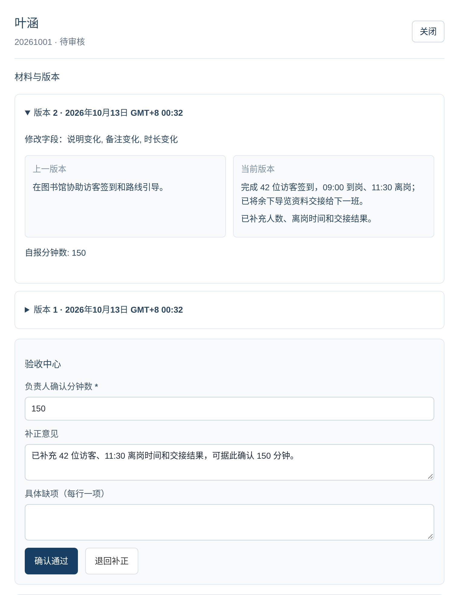

</details>

<details>
<summary>查看集体活动的公共材料与逐人确认</summary>

集体活动由负责人提交公共材料，再分别确认每个人的结果和时长。活动也可以同时要求个人补充。

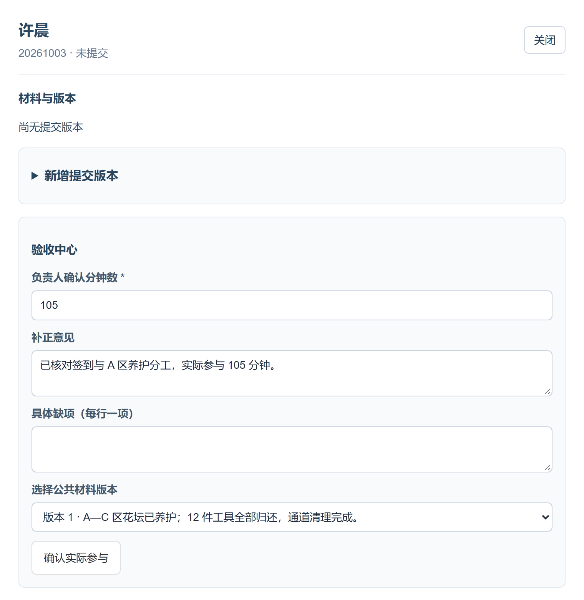

</details>

### 5. 结项并导出结果

下载 CSV、Excel，或包含名单与已确认材料的 ZIP 包。完成、退出、未完成的人员都保留在名单中。后续更正会生成新的结项版本，原记录继续保留。

名单依次列出姓名、学号/工号、外部编号、部门、分组、名单来源、结果和确认分钟数，内部编号放在最后。文件按“任务名称_结果版本N”命名。

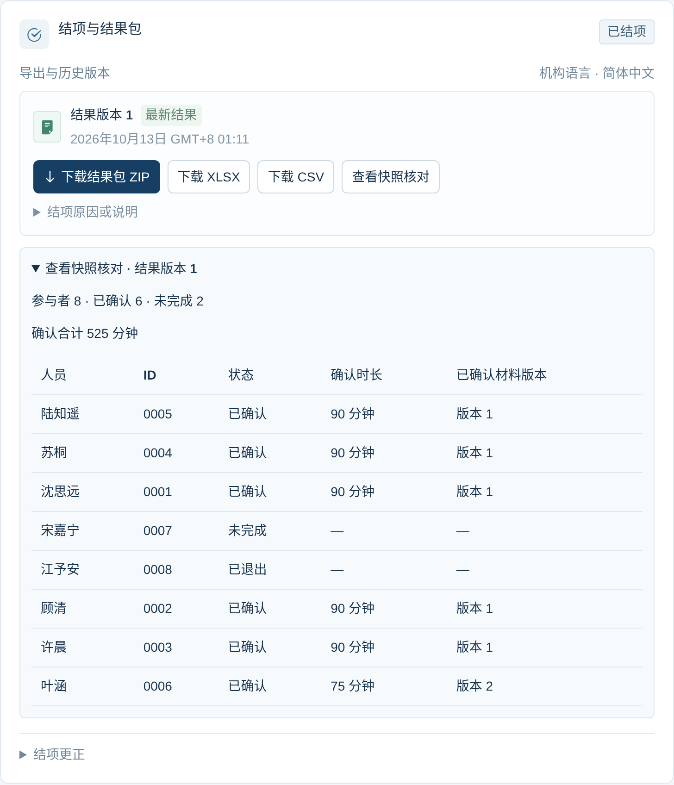

### 管理终端

管理员负责账号审批、组织与机构设置、负责人交接、通知和数据保存，并设置学生自助注册方式（开放、需审核或不开放），可以一次通过本页全部待审核账号，也可以为用户重置密码。机构还没有任务时，管理首页会列出开始使用的步骤。

<details>
<summary>查看管理概览</summary>

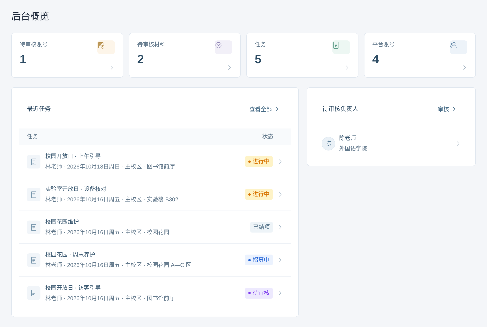

</details>

截图中的学校（示例大学）、人员和活动均为虚构。

## 本地运行

需要 Node.js `>=24.13.1 <25` 和 npm。

```sh
git clone https://github.com/tswawa/CampusCollab.git
cd CampusCollab
npm ci
```

将 `.env.example` 复制为 `.env`，然后启动：

```sh
npm run dev
```

打开 [localhost:5173](http://localhost:5173)。API 默认端口为 `3000`，数据库在启动时自动迁移。

首次访问时选择语言、填写机构信息与时区，选择学生注册方式，并创建管理员。安装码使用 `.env` 中的 `SETUP_TOKEN`；留空时，由部署负责人读取首次启动生成的 `data/campus.sqlite.setup-token` 文件。

## 部署

在 `.env` 中设置 `NODE_ENV=production`、实际的 HTTPS `APP_ORIGIN`，以及数据库、图片和备份的持久路径，然后运行：

```sh
npm run build
npm start
```

服务默认监听 `127.0.0.1:3000`，通过反向代理提供 HTTPS，并将 `TRUST_PROXY` 设为该代理的地址。配置、备份、升级和恢复步骤见[运维说明](docs/operations.md)。

## 开发

前端使用 Vue 3、Pinia 和 Vant，后端使用 Fastify 与 Node 内置 SQLite。

```sh
npm run format:check
npm run type-check
npm run test:api
npm run test:client
npx playwright install chromium
npm run test:e2e
```

- [架构与项目边界](docs/ARCHITECTURE.md)
- [贡献说明](CONTRIBUTING.md)
- [产品计划与调研](PLAN.md)
- [验证说明](docs/verification.md)
- [安全问题报告](SECURITY.md)

## 许可证

采用 [AGPL-3.0-only](LICENSE)。项目基于 ZVMS4 前端开发，保留[上游 MIT 版权和许可声明](LICENSES/ZVMS-MIT.txt)，详见 [NOTICE](NOTICE)。生产构建附带对应源码包 `/source.zip`。
