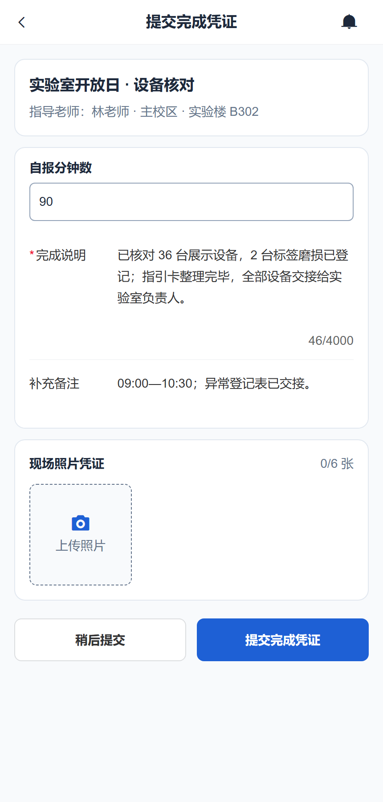

# 高校任务协作平台 · CampusCollab

**从参与名单，到材料审核和结项归档。**

[English](README.md) · [本地运行](#本地运行) · [文档](docs/README.md)

[](https://github.com/tswawa/CampusCollab/actions/workflows/ci.yml)

一场活动结束，名单、材料和参与时长还要逐一核对。CampusCollab 把这些事情放在每个人的记录里：谁还没交、谁需要补充、谁已经通过，都能从名单上找到。

负责人可以导入已有名单，也可以发布任务让学生报名。收齐材料、完成审核后，直接导出结果名单和已确认的材料。适合校园志愿活动、学生组织和院系实践项目。

## 从名单找到下一件要处理的事

按未提交、待审核、待补正、已确认筛选，或直接搜索姓名和编号。已有 CSV 名单可以先预览再导入，学号按文本保留。


## 补充了什么，审核的是哪一版

打开一个人的记录，写下具体要求，例如“补充实际离场时间”。对方重新提交后，可以查看新旧版本和之前的意见，再确认这一版材料与实际参与时长。准备齐全的材料也可以批量审核。


## 一份活动材料，每个人各记各的时长

集体活动由负责人上传公共材料，再逐人确认结果。有人完成了 90 分钟，有人提前离场、实际参与 75 分钟，都会分别记录。需要个人补充的活动，也可以同时收集个人材料。


## 名单和对应材料一起交出去

结项后可以下载 CSV、Excel，或包含名单与已确认材料的 ZIP 包。完成、退出和未完成的人员都保留在名单中，通过审核的记录可以对应到当时确认的材料。

后续需要更正时，生成新的结项版本，原来的记录继续保留。


## 学生端与管理端

学生可以在手机或电脑上浏览任务、报名、提交图文材料、处理补正并查看结果。管理员负责账号审批、组织设置、负责人交接、通知和数据保存。

<details>
<summary>查看学生手机端</summary>



</details>

<details>
<summary>查看管理概览</summary>


</details>

每所学校独立部署一个 Node.js 应用和 SQLite 数据库。首次初始化由管理员选择中文或英文，界面、系统通知和导出使用机构设定的语言。

截图使用虚构活动数据，以中国海洋大学作为机构名称示例。

## 本地运行

需要 Node.js `>=24.13.1 <25` 和 npm。

```sh
git clone https://github.com/tswawa/CampusCollab.git
cd CampusCollab
npm ci
```

将 `.env.example` 复制为 `.env`，然后启动：

```sh
npm run dev
```

打开 [localhost:5173](http://localhost:5173)。API 默认端口为 `3000`，数据库在启动时自动迁移。

首次访问时选择语言、填写机构信息与时区，并创建管理员。安装码使用 `.env` 中的 `SETUP_TOKEN`；留空时，由部署负责人读取首次启动生成的 `data/campus.sqlite.setup-token` 文件。

## 部署

在 `.env` 中设置 `NODE_ENV=production`、实际的 HTTPS `APP_ORIGIN`，以及数据库、图片和备份的持久路径，然后运行：

```sh
npm run build
npm start
```

服务默认监听 `127.0.0.1:3000`，通过反向代理提供 HTTPS。配置、备份、升级和恢复步骤见[运维说明](docs/operations.md)。

## 开发

前端使用 Vue 3、Pinia 和 Vant，后端使用 Fastify 与 Node 内置 SQLite。

```sh
npm run type-check
npm run test:api
npm run test:client
npx playwright install chromium
npm run test:e2e
```

- [架构与项目边界](docs/ARCHITECTURE.md)
- [贡献说明](CONTRIBUTING.md)
- [产品计划与调研](PLAN.md)
- [验证说明](docs/verification.md)
- [安全问题报告](SECURITY.md)

## 许可证

采用 [AGPL-3.0-only](LICENSE)。项目基于 ZVMS4 前端开发，保留[上游 MIT 版权和许可声明](LICENSES/ZVMS-MIT.txt)，详见 [NOTICE](NOTICE)。生产构建附带对应源码包 `/source.zip`。
