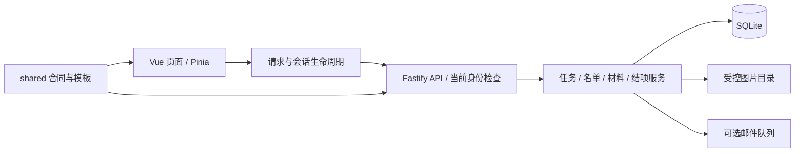

# CampusCollab 架构与项目边界

本文说明运行链路、模块职责和项目边界。测试范围见[验证说明](verification.md)，部署步骤见[运维说明](operations.md)。

**每所学校独立部署一个 Node.js 应用实例、一套 SQLite 数据库和附件目录。中文与英文共用同一实现，语言由机构统一设置。** 保持这一规模与职责划分；不为清理项目引入微服务、消息中间件或替换框架。

## 正式入口与运行形态

浏览器入口是 `index.html → src/main.ts → src/App.vue → src/router/index.ts`。正式页面、状态、请求与样式位于 `src/mobile/`；名称中的 mobile 不表示只有手机端，管理端和桌面工作台也在这里。Vue Router 的懒加载页面清单决定可进入的功能。

服务入口是 `server/index.ts → server/app.ts`。应用加载配置、取得数据库租约、执行迁移，注册会话和 API，并在生产模式提供 `dist/` 的前端资源。开发时 Vite 将 `/api` 代理给 Node；`npm run preview` 只预览前端，不能替代完整应用。

运行环境为 Node.js 24（项目约束 `>=24.13.1 <25`）与 npm；该最低版本包含 Windows 中文路径删除修复，应用及维护入口在开库前检查运行版本。SQLite 使用 Node 内置 `node:sqlite`，不依赖外部数据库服务。原生 Node 是当前部署与验收路径；保留的容器文件是可选部署资料，不能据本机结果声称它们已重新验收。

## 模块职责

| 范围 | 职责与边界 |
| --- | --- |
| `src/mobile/pages`、`components`、`styles` | 角色页面、交互与响应式布局；不自行裁定权限或写数据库。 |
| `src/mobile/stores`、`api` | 使用服务端 DTO，管理加载、冲突、取消与会话切换；页面状态不是业务事实的权威。 |
| `shared/contracts.ts`、`workflow-contracts.ts` | 浏览器与服务端共享的请求、响应和状态类型；不包含密码哈希或会话秘密。 |
| `shared/templates.ts`、`institutional-templates.ts` | 版本化材料要求与可核对的模板格式；历史模板格式验证不等于学校当前接收承诺。 |
| `server/modules/tasks*`、`workflow*` | 任务发布、报名录取、名单、绑定、版本提交、审核、异常结果、更正和结项。路由校验输入，服务执行业务不变量。 |
| `server/modules/files-settings.ts`、`completion-export.ts` | 图片规范化与访问、机构设置、按指定快照生成结果包。 |
| `server/security`、`modules/auth.ts`、`accounts.service.ts` | 会话、密码、当前角色/审批状态和账号生命周期；任务数据权限仍在业务入口复核。 |
| `server/db`、`installation` | 数据库、迁移、单实例租约、一次性初始化；不可把已有业务库重新认领为空安装。 |
| `server/retention`、`mail`、`i18n` | 受控保存期删除、可选邮件传输、机构语言下的系统消息。 |
| `server/scripts`、`scripts`、`server/tests`、`tests/e2e` | 停服维护、构建与对应源码打包、隔离验证。演示种子只用于明确的虚构数据场景。 |

依赖保持有明确用途：Vue/Pinia/Router/Vant 负责界面；Fastify 及插件处理 HTTP；TypeBox 描述边界输入；Temporal 处理机构时区；Sharp 规范化图片；ExcelJS/fflate 生成结果包；Nodemailer 仅承担启用后的邮件传输。旧目录残留的 import 不能作为增装旧框架依赖的理由。

## 状态权威与业务不变量

| 对象 | 权威事实 | 不可混淆的派生信息 |
| --- | --- | --- |
| 任务是否允许更正/写入 | `workflow_tasks.status` 的 open/closed，以及任务的明确取消状态 | `calculateTaskStatus` 汇总展示的 recruiting/review/completed 不等于工作流已经结项。 |
| 个人参与结果 | `workflow_participants.status`、version 及审核记录 | `task_members` 是仍被现有入口使用的兼容投影，不得单独形成另一套工作流。 |
| 是否曾获录取 | 持久 `admitted` 事实 | 当前 completed、补正或取消恢复不能反推或补授录取。旧歧义记录保守保留历史，不猜测授权。 |
| 材料与确认结果 | 不可变 revision、明确 confirmed/common revision ID、负责人确认分钟 | 最新材料、自报分钟、计划分钟均不自动等于获确认材料或实际时长。 |
| 历史结项 | 不可变 snapshot、version 与 supersedesId | 当前名单可以经更正改变，旧快照和已下载的包不会被静默改写。 |

报名截止约束学生自主申请或领取。负责人显式审批已有申请、邀请和 CSV 导入属于开放工作流的名单管理，按权限、非取消状态、容量、身份/版本，以及该入口适用的受众规则判断；不得因为其他成员已经完成、展示进度汇总为 completed 而封死更正录取。真正 closed 或 cancelled 仍禁止写入。

导入身份与登录账号分开：文本外部编号保留前导零，导入不创建账号，同名不自动合并，绑定须明确选择既有账号。未录取的异常终态发起更正应回到 applied，后续经过显式审批；已录取者更正不能绕过名额约束。

同一业务修改使用同步数据库事务与版本检查。SQLite 单实例和 `BEGIN IMMEDIATE` 是当前一致性边界；不要在事务回调中放异步工作。图片处理、密码哈希或导出等异步步骤，必须在真正写入/释放私有内容前重新核验当前身份与对象状态。

个人提交与公共材料是不同的确认入口。普通个人审核确认指定个人版本；集体确认明确关联一个公共版本，并按设置要求个人补充。不要把“存在公共材料”自动解释为“所有成员均确认了它”，也不要默认导出所有公共历史。结项保留完整名单，只有已完成人员的明确确认版本进入材料包；完成者必须有确认分钟。

## 文件归属、引用与删除

图片由服务规范化后保存在上传目录，数据库保存元数据与访问关系。支持 JPEG、PNG、WebP；不接受任意可执行文件或通用文档上传。

- 临时图片属于上传者和对应任务；提交后通过 `workflow_revision_files` 等关系成为材料引用。删除或临时清理必须检查引用，不能仅凭过期时间判断。
- 跨任务复用建立明确的来源版本与文件引用，不改变来源任务的附件所有权。清理消费任务只解除自己的引用并清除自有文件；来源仍被其他任务引用时不得清除。
- 学校当前 Logo 是已发布机构资源。删除上传账号时必须处理或保护该机构引用，不能让学校设置留下不存在的文件 ID。账号可删除不代表其全部文件可无条件级联消失。
- 保存期删除先预览，提交时重新验证管理员、任务版本、哈希、到期条件和引用，再在事务中删除记录。物理删除失败保留可重试记录，不把数据库已删等同磁盘字节已删。
- 邮件 sending 只代表当前真实执行中的操作。重新取得实例租约后应将遗留中断状态恢复为未知结果，即使邮件已关闭；恢复状态不等于重新发送。真正仍在发送的邮件继续阻止相关任务清理。

导出上限为 5000 人和 50MB，缺少获确认材料时明确失败，不能返回声称完整的部分包。导出后的校验清单只校验文件完整性，不证明活动真实性。保存期清理不会自动删除外部备份或已下载结果包。

## 会话、权限与界面生命周期

认证使用服务端 SQLite 会话和 HttpOnly Cookie；修改请求同时校验受信 Origin 与 CSRF。会话解析读取当前账号与审批状态；浏览器角色路由仅提供导航保护，不能替代 API 权限判断。

`src/mobile/api/index.ts` 为请求维护会话代际、取消信号和超时；退出、换号或失效使旧响应无效。bootstrap 清空角色数据并卸载旧页面；页面加载与修改在卸载时取消，任务失权还应清除该页私有数据。Blob 下载与图片预览同样属于当前身份和页面生命周期：第三方挂载到 body 的预览也须显式关闭，不能因它不在 RouterView 内而例外。

机构语言来自学校设置，影响界面、系统通知、邮件和导出；用户正文不自动翻译。时间保存明确时间点，按机构 IANA 时区输入与显示；语言切换不能改变截止时刻。

## 构建、对应源码与恢复边界

`npm run build` 执行类型检查、Vite 前端构建、服务端 TypeScript 编译及 `scripts/package-source.mjs`。运行产物为 `dist/` 和 `dist-server/`；启动迁移仍需要 `server/db/migrations/*.sql`，不能只搬走编译目录。

`dist/source.zip`、`LICENSE.txt`、`NOTICE.txt` 与所部署构建对应。源码包应包含重建当前应用需要的源文件、构建配置、迁移、测试和许可资料；不得包含部署环境、运行数据、账号凭据或本地会话目录。退役代码应从正式源树归档，不能为了维持它可编译而重新接入正式运行链路。保留上游 MIT 声明及本应用现有许可文件。

应用与维护命令共用 `<database>.lock/lease.sqlite` 内核租约。维护前停服；异常退出后由操作系统释放锁，不通过删除或搬走锁强开第二实例。数据库、附件和备份路径互相独立，使用本机磁盘；共享网络文件系统和多实例不在当前支持边界。

备份使用停服后的数据库一致副本与完整附件目录，并记录迁移信息；备份命令不先升级原库。恢复先检查格式、版本、关联和附件，建立恢复前安全副本，再替换数据库与附件，并清空会话。升级回退同时匹配程序版本、数据库和附件；不能将旧代码直接指向已升级库。配置、域名、HTTPS 和异地备份由部署方另行管理。现有恢复的异常处理与安全副本不等于已经承诺任意断电窗口都能自动跨文件回滚。

## 明确不做的事

本项目不提供跨学校多租户、支付结算、工资发放、自动学分或活动真实性认定，也不凭通用模板承诺学校正式接收。没有已实现或已授权的官方 SSO 接入，不能把它写成现有能力。没有离线写入同步、后台推送或自动服务升级能力声明；网页 manifest 与图标不等于这些功能已经实现。

清理的目标是让正式源码、发布内容和职责容易理解，不是抹掉用户素材、旧版本证据或迁移历史。旧 API/组件、原型、演示工程和历史技术报告不属于当前功能入口；它们的保留位置由有回滚记录的清理计划决定。审查报告记录某次版本的事实，不代替当前验收。

## English summary

CampusCollab is one native Node.js application with one SQLite database per institution. Vue, Pinia, Vant and the routes under `src/mobile` form the production UI; Fastify services own authorization and workflow rules. `shared` defines portable DTOs and versioned templates.

Workflow closure, cancellation, participant outcome, durable admission and evidence confirmation are separate facts. Aggregated task progress is for display and must not block explicit roster correction in an open workflow. Student self-signup remains subject to its deadline. Files retain their original ownership across references; snapshots are immutable and exports include only explicitly confirmed evidence.

Sessions and private UI resources share an identity lifecycle. Maintenance runs with the application stopped, using the same exclusive database lease. Restore covers the database and uploads, invalidates sessions and retains a safety copy. The project does not claim multi-tenancy, payments, automatic institutional certification, official SSO, offline synchronization or crash-proof cross-file restore. Historical evidence and user material remain separate from the maintained product tree.
